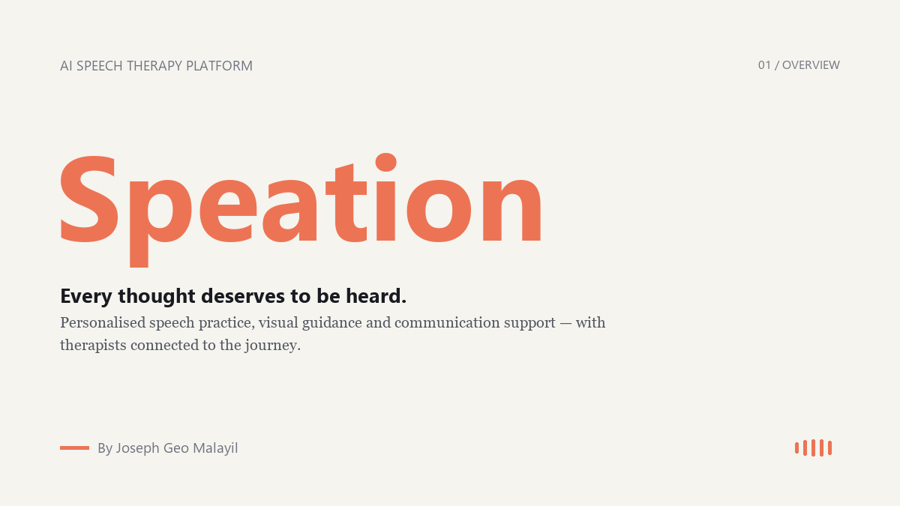
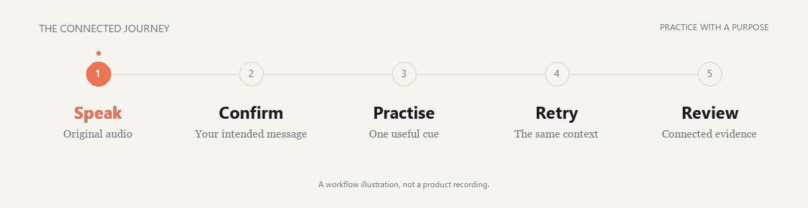
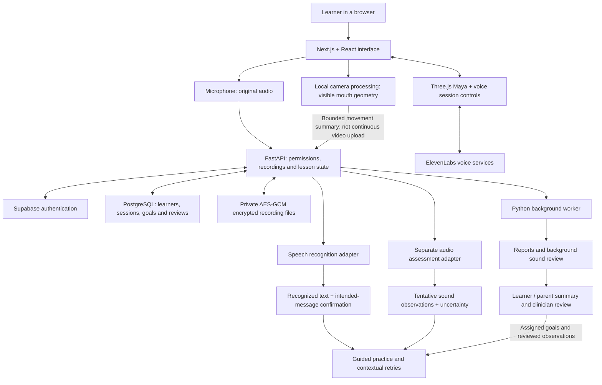

<div align="center">

<picture>
  <source media="(prefers-reduced-motion: reduce)" srcset="assets/readme/speation-cover-static.png">
  
</picture>

**English-first** &nbsp; / &nbsp; **Child and student experiences** &nbsp; / &nbsp; **Clinician review**

Joseph Geo Malayil · Team LUMOS

[The problem](#the-problem) · [The experience](#the-experience) · [Architecture](#architecture) · [Technology](#technology) · [Project status](#project-status) · [Running the workspace](#running-the-workspace)

</div>

---

## The problem

A child has something to say, but getting the words out clearly is difficult. A student knows their project, but struggles to explain it during an interview. Families need useful practice between appointments; clinicians need more context than a recollection of what happened at home.

Travel, recurring appointments and limited access to specialists can make consistent support difficult. A recording button alone does not close that gap. Learners need an understandable next step, a reason to practise and a way to use that practice in everyday communication.

**Speation connects communication, guided practice and real-world rehearsal in one workflow.**

## The experience

### 01 · Say what matters

Record a message, check its interpretation and confirm or edit the intended meaning. The confirmed message can be spoken aloud. For learners who use assisted communication, an optional **AAC** page provides another way to express a message; its visibility is controlled in settings.

The original recording stays separate from the confirmed text. A useful interpretation of the message is not automatically an accurate account of every sound produced.

### 02 · Learn with Maya

Maya has two separate purposes:

| Experience | What it does |
| :--- | :--- |
| **Daily conversation** | Voice conversation with listening, playback, interruption and session recovery controls. |
| **Learn with Maya** | Guided activities built around messages, meaningful contexts and practice targets. |

Learning activities occupy the main stage:

- **My Message:** confirm the intended message and optionally practise a useful word.
- **Story Adventure:** narrated, illustrated SVG animatics with scenes and spoken responses.
- **Hear the Difference:** picture-based sound comparisons, familiarisation, listening choices and optional spoken practice.
- **Familiar Example:** Maya's example or a privately supplied familiar adult's demonstration, with segment replay and a slower playback option.
- **Bakery practice:** an adapted game that connects speaking attempts with the baking activity.

Teaching combines spoken examples, manageable cues and illustrative mouth demonstrations. A camera mirror can provide visible lip-movement feedback. Unclear audio should lead to an uncertainty state, rather than an automatic failure.

### 03 · Take practice into the real world

The **16+ speaking studio** offers three English-language meeting experiences:

| Experience | Preparation | During the meeting | Afterward |
| :--- | :--- | :--- | :--- |
| **Mock interview** | Enter a role or goal; optionally upload a résumé and review its extracted skills, projects, experience and education. | Maya opens with an introduction question, asks tailored questions and follows up on answers. | Review specific feedback, practise a chosen word and retry the original question. |
| **Group discussion** | Choose a topic, communication focus and supportive or challenge mode. | Maya moderates three AI candidates. Select whom to respond to, raise a hand and use speaking-support controls. | Review contributions, supporting evidence and a focused retry. |
| **Presentation** | Upload a PDF or PPTX and review its text and notes. | Slides occupy the main stage. Use slide controls or separate spoken navigation commands, then enter audience Q&A. When delivery recordings are available, Q&A preparation uses those answers as well as the slides. | Review slide participation, answer feedback and the original/retry recordings. |

**Support is part of the meeting:** manual answer submission, adjustable pauses, repeated questions, answer outlines, “give me a moment” and immediate session ending. Extended rehearsal recordings support answers of nearly three minutes; Sarvam recognition splits longer recordings into shorter provider requests.

AI candidates are simulated participants with distinct voices and roles. They are not real attendees or live human video streams.

### 04 · Keep the evidence connected

Reports bring together:

- **Communication feedback:** strengths, a focused next step and supported quotations from an answer.
- **Recorded measurements:** recognized word count, speaking pace, voice-activity pause estimates and transcript-detected fillers or adjacent repeated words.
- **Sound observations:** separate background audio review, uncertainty and intended-word confirmation before practice.
- **Practice continuity:** the original question, a supported retry, both recordings and measured changes.
- **Parent and clinician workflows:** understandable progress summaries, recording review and assigned goals that can inform future practice.

Missing measurements are shown as unavailable. Faster speech, fewer pauses or a lower filler count are not automatically treated as better communication.

## What makes the approach different

<picture>
  <source media="(prefers-reduced-motion: reduce)" srcset="assets/readme/speation-flow-static.png">
  
</picture>

### Understanding the message and examining the sounds are different tasks

Suppose the intended word is **“green”**, but the recording may contain **“breen.”** A recognizer can still output “green” because that word fits the sentence.

Speation preserves three distinct kinds of information:

| Layer | Question it addresses | What it cannot establish by itself |
| :--- | :--- | :--- |
| **Message recognition and confirmation** | “What did you want to say?” | Whether every sound was produced as expected. |
| **Independent audio review** | “Is there a supported sound difference worth checking?” | A guaranteed phonetic transcription or a validated diagnosis. |
| **Visible movement feedback** | “Can you see your lips opening, closing or rounding?” | Hidden tongue placement or correct pronunciation. |

When an audio observation supports a possible difference, the learner can confirm the intended word, hear an example, see a demonstration and make a fresh attempt. When evidence is insufficient, the interface should say so.

### Practice returns to its original purpose

The goal is more than completing an isolated word drill:

> **A meaningful answer → one useful practice target → guided support → the same question again → evidence to review.**

The before/after report preserves context and support used. It does not manufacture a percentage improvement from changing pace or transcript similarity.

## Architecture



Camera tracking and audio assessment provide different evidence. The diagram does not imply that webcam geometry is a phoneme grader or that every provider is used on every turn.

## Technology

| Area | Implementation | Purpose |
| :--- | :--- | :--- |
| Web application | **Next.js 15, React 19, JavaScript, CSS modules** | Shared recording, playback, activity and report interfaces. |
| 3D companion | **Three.js**, custom timing and facial-animation code | Render Maya and coordinate illustrative mouth animation with speech playback. |
| Camera | **MediaPipe Tasks Vision**, browser canvas and Web Workers | Local facial landmarks and visible lip geometry. Visible-tongue exercises also use calibrated colour segmentation. |
| API | **Python, FastAPI, Uvicorn, Pydantic** | Validate requests and structured model responses; manage workflows and access. |
| Identity and structured data | **Supabase Auth, PostgreSQL, SQLAlchemy, asyncpg** | Learner ownership, permissions, sessions, goals and reviews. |
| Private recordings | **AES-GCM encrypted files** with authorized backend access | Keep retained audio separate from public assets. |
| Recognition adapters | **Sarvam, Deepgram, faster-whisper** | Configurable cloud or local message-recognition paths. |
| Audio feedback | **OpenRouter audio-model integration**, optional **Azure Pronunciation Assessment** and local phone-model adapters | Separate audio observations from recognized text; expose uncertainty and configuration limits. |
| Coaching and summaries | **Configurable LLMs through OpenRouter** | Structured résumé parsing, contextual questions, feedback and report drafts. |
| Voice output | **ElevenLabs**, with a **Sarvam** synthesis fallback on supported paths | Spoken questions, examples and responses. Participant voice presets are configurable. |
| Signal processing | **librosa, NumPy, SciPy, soundfile, PyAV**, voice-activity analysis | Audio decoding, timing and descriptive measurements. |
| Pronunciation references | **eSpeak NG** | Expected text-to-phoneme references, separate from observed learner sounds. |
| Documents | **PyMuPDF, python-pptx** | PDF/PPTX content extraction and supported previews. |
| Asynchronous work | **Python care worker** and database-backed job state | Background review and lifecycle tasks without making every learner turn wait. |

Provider availability depends on credentials, consent, downloaded model weights and the selected workflow. **Allosaurus and Montreal Forced Aligner are not the active companion assessment pipeline.**

## Project status

> **Working local prototype · source publication in progress.**
>
> This repository is being published in batches. The full local workspace contains application files, assets and verification tools that are not all present in this checkout yet. **The published checkout is not currently a complete, reproducible release.** Database migrations and test files are being kept outside the current publication batches.

### Verified in the full local workspace

| Check | Latest recorded result | What it establishes |
| :--- | :--- | :--- |
| Relevant backend regression suite | **45 passed** | Tested application behaviour, including synthetic rehearsal journeys, permissions and reporting. Provider responses are mocked in those journeys. |
| Frontend checks | **78 passed** | The covered logic and source/interface checks pass; this is not a substitute for browser interaction testing. |
| Production frontend build | **176 pages generated** | The full local frontend compiles and builds. |
| Meeting voice inventory | **Four distinct configured voices available** | Provider inventory availability, not a guarantee of successful playback on every device. |

Actual microphone, speaker, camera and end-to-end browser behaviour still require device testing. No CI badge or public test execution is claimed here.

### Deliberate boundaries

- Maya's facial animation is approximate; **exact live phoneme lip sync is not completed**.
- A webcam cannot verify hidden tongue placement. Teaching cutaways are illustrations, not reconstructions of the learner's mouth.
- **Validated per-learner model training and representative pronunciation-accuracy evaluation remain unfinished.**
- English is the current assessment and rehearsal focus. Hindi/Malayalam interface and recognition paths do not imply equivalent pronunciation-assessment validation.


<details>
<summary><strong>Research data: what the experiments do and do not prove</strong></summary>

The full local workspace includes research tooling and subsets involving **IEdysarthria**, **SpeechOcean762** and **TORGO**, alongside other recognition/fluency experiments.

- **IEdysarthria:** the local corpus has 73 sentences from one adult male speaker. It is useful for a limited research pilot, not representative child validation.
- **SpeechOcean762:** pronunciation-rated learner speech supports exploratory evaluation, but second-language pronunciation data is not a dysarthria cohort.
- **TORGO:** an author-hosted sample is used for separate corpus checks; this does not mean the full corpus is bundled or that generalisation has been established.

Datasets, patient recordings, downloaded weights and personal training artifacts are not distributed in this repository. Dataset access, attribution and permitted use must follow the respective source terms. No general accuracy figure is asserted from these subsets.

</details>

## Running the workspace

**The commands below describe the complete local workspace. They do not bypass the incomplete-publication status above.**

Prerequisites: Node.js **22.22+**, a Python environment compatible with `backend/requirements.txt`, a separately provisioned database schema, and credentials/model files for the features being enabled.

1. Create a Python virtual environment and install the backend requirements.
2. Create a private root `.env` using `.env.example` as a configuration reference. Set authentication, database, allowed origins and recording encryption. Configure only the speech/model providers you intend to use. Some example comments reflect earlier research components; the backend configuration is the source of truth.
3. Set the frontend's public Supabase configuration in `frontend/.env.local`, and set `BACKEND_INTERNAL_URL=http://127.0.0.1:8100` for the local proxy. Never put service-role credentials, model-provider secrets or encryption keys in `NEXT_PUBLIC_*` variables.
4. Start the application services in separate terminals.

**API — from the project root, with the virtual environment active:**

```bash
python -m uvicorn main:app --app-dir backend --host 127.0.0.1 --port 8100
```

**Frontend:**

```bash
cd frontend
npm ci
npx next dev -p 3100
```

**Background worker — PowerShell, from the project root:**

```powershell
$env:PYTHONPATH = "backend"
python -m scripts.care_worker
```

<details>
<summary>Background worker — macOS/Linux</summary>

```bash
PYTHONPATH=backend python -m scripts.care_worker
```

</details>

Open `http://localhost:3100`. Use learner permissions to configure cloud processing and recording retention. `/health/ready` on the API reports configured readiness; it is not a clinical validation endpoint.

<details>
<summary><strong>Useful application routes in the complete workspace</strong></summary>

| Route | Purpose |
| :--- | :--- |
| `/companion` | Daily conversation and Learn with Maya. |
| `/speech-translator` | Message confirmation, playback and optional practice. |
| `/arcade` | Speaking activities and games. |
| `/speaking-lab` | Interview, group discussion and presentation rehearsal. |
| `/care-progress` | Learner practice and progress experience; `/progress` redirects here. |
| `/family` | Family support tools. |
| `/clinician` | Assigned clinician workspace. |
| `/settings` | Learner preferences, including optional AAC visibility. |

</details>


Speation · Joseph Geo Malayil · LUMOS

</div>
